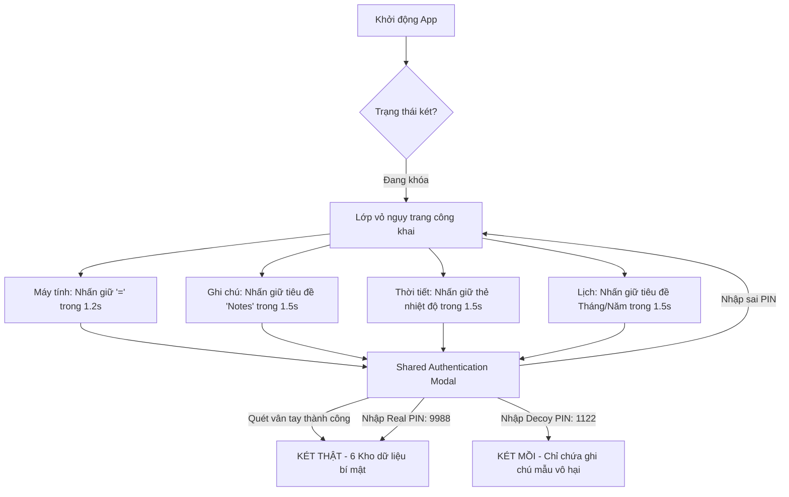

# 🛡️ PROJECT MASTER CONTEXT: HIDDER (STEALTH PRIVACY VAULT)
> **Tài liệu tổng quan dự án dành cho AI (AI Context Document)**  
> *Được biên soạn đầy đủ, súc tích để bất kỳ mô hình AI nào (ChatGPT, Claude, DeepSeek, Gemini,...) khi đọc xong đều có thể nắm vững 100% kiến trúc, tính năng, luồng nghiệp vụ, công nghệ và trạng thái hiện tại của dự án.*

---

## 1. THÔNG TIN DỰ ÁN & BỐI CẢNH (PROJECT BACKGROUND)

* **Tên ứng dụng:** **Hidder - Stealth Privacy Vault** *(hoặc Hidder - Calculator Vault)*
* **Loại ứng dụng:** Ứng dụng di động Két sắt bảo mật ngụy trang (Stealth Vault / Camouflage Security App).
* **Môn học & Đề tài:** Đồ án Khởi nghiệp / Phát triển sản phẩm MVP (**EXE201 / EXE202** - Đại học FPT).
* **Nền tảng & Định dạng:** Android Mobile App (`.aab` cho Google Play Store, `.apk` cho máy kiểm thử nội bộ).
* **Mã định danh gói (Package Name):** `com.hidder.app`
* **Phiên bản hiện tại:** `1.0.0` (Mã phiên bản: `versionCode: 9`).
* **Trạng thái phát hành:** Đang trong chương trình **Thử nghiệm kín (Closed Testing)** trên Google Play Console, tuân thủ quy định tối thiểu 20 testers trong 14 ngày của Google.

---

## 2. Ý TƯỞNG CỐT LÕI & GIẢI PHÁP SẢN PHẨM (VALUE PROPOSITION)

### 2.1. Vấn đề giải quyết (Problem)
1. **Bị nhìn lén / tò mò:** Bạn bè, người thân mượn điện thoại có thể vô tình hoặc cố ý xem ảnh nhạy cảm, tin nhắn, tài liệu công việc hoặc mật khẩu.
2. **Nguy cơ từ các app khóa thông thường:** Các ứng dụng AppLock / Photo Vault truyền thống đều có icon hình ổ khóa hoặc két sắt lộ liễu, gây nghi ngờ và kích thích đối phương đòi mật khẩu.
3. **Tình huống bị cưỡng ép (Under Duress):** Khi bị người khác ép buộc mở ứng dụng trước mặt họ, người dùng không có cách nào từ chối an toàn.

### 2.2. Giải pháp độc đáo của Hidder (Solution)
1. **Ngụy trang hoàn hảo (Stealth Camouflage):** 
   - Ứng dụng khoác lên mình 4 lớp vỏ tiện ích công khai hoạt động thật: **Máy tính cầm tay (Calculator), Ghi chú (Notes), Dự báo thời tiết (Weather), Lịch cá nhân (Calendar)**.
   - Hỗ trợ đổi **Dynamic App Icon ngoài màn hình chính Android**: App đổi icon và đổi tên hiển thị tương ứng (Icon máy tính tên "Calculator", icon thời tiết tên "Weather",...).
2. **Cơ chế phòng vệ 2 mã PIN (Dual PIN Duress Defense):**
   - **Real PIN (Mã thật):** Mở Két thật chứa dữ liệu bí mật thực sự.
   - **Decoy PIN (Mã mồi):** Mở Két giả lập hoàn toàn vô hại (chỉ chứa vài ghi chú mẫu bình thường), đánh lừa người theo dõi khi bị ép mở app.
3. **Đa kho lưu trữ bảo mật (6-in-1 Multi-Vault):**
   - 📸 **Photo Vault:** Lưu trữ ảnh nhạy cảm cô lập trong sandbox.
   - 🎥 **Video Vault:** Xem và quản lý video bí mật.
   - 📄 **Document Vault:** Bảo vệ tài liệu văn bản, PDF, Word, hợp đồng.
   - 🎙️ **Voice Vault:** Thu âm trực tiếp và phát lại voice memos bí mật.
   - 🔑 **Password & Card Vault:** Quản lý tài khoản đăng nhập và thẻ thanh toán quốc tế (hỗ trợ copy nhanh và che giấu trường CVV).
   - 📝 **Private Notes:** Soạn thảo ghi chú mật.
4. **Bảo vệ tức thì (Instant Auto-Defense):**
   - Tự động khóa két ngay khi ứng dụng bị ẩn xuống chạy ngầm hoặc chuyển app (`AppState`).
   - Nút **Quick Escape** một chạm để văng ra lớp vỏ ngoài ngay lập tức.
5. **Mô hình Freemium Cloud Storage:**
   - Miễn phí trọn đời lưu trữ trên thiết bị (Local Vault - không bao giờ khóa).
   - Tặng sẵn 256MB lưu trữ đám mây Supabase vĩnh viễn.
   - Mở rộng dung lượng qua thanh toán VietQR / PayOS tự động.

---

## 3. KIẾN TRÚC KỸ THUẬT & CÔNG NGHỆ (TECH STACK)

| Phân hệ | Công nghệ / Thư viện | Vai trò & Mục đích |
| :--- | :--- | :--- |
| **Mobile Framework** | **React Native 0.81.5 + Expo SDK 54** | Nền tảng phát triển ứng dụng di động (Bare Workflow / Prebuild Android). |
| **Mã hóa (Zero-Knowledge)** | `@noble/ciphers/aes.js` (AES-256-GCM) | Mã hóa cục bộ trước khi đồng bộ (Client-Side Encryption), ngăn chặn lộ dữ liệu trên Cloud. |
| **Phần cứng bảo mật** | `expo-secure-store` | Lưu trữ an toàn Real PIN, Decoy PIN, Master Key vào Android Keystore. |
| **Sinh trắc học** | `expo-local-authentication` | Mở khóa két nhanh bằng Vân tay hoặc FaceID. |
| **Sandbox tệp tin** | `expo-file-system` | Cô lập các tệp media trong thư mục ứng dụng an toàn. |
| **Media & Tệp** | `expo-image-picker`, `expo-document-picker`, `expo-av` | Chọn nhiều ảnh/video cùng lúc, import file tài liệu, thu âm và phát âm thanh. |
| **CSDL Cục bộ** | `@react-native-async-storage/async-storage` | Lưu trữ metadata tệp, ghi chú, cài đặt (mô hình Local-First). |
| **Backend & Cloud** | **Supabase** (PostgreSQL + Supabase Auth + Supabase Storage) | Xác thực tài khoản (Google OAuth / Email), đồng bộ hóa hàng đợi dữ liệu 2 chiều. |
| **Thanh toán QR** | **VietQR / PayOS** | Cổng thanh toán quét mã QR tự động xác thực ngân hàng. |
| **Đo lường (Analytics)** | **Google Analytics 4 (GA4)** Measurement Protocol | Thu thập dữ liệu sử dụng sản phẩm và phễu chuyển đổi kinh doanh. |

---

## 4. BÍ MẬT CỬ CHỈ MỞ KHÓA & TRUY CẬP (HIDDEN TRIGGERS)

Để đội ngũ kiểm duyệt hoặc AI hiểu cách thức mở két bí mật trong ứng dụng:



* **Mở Cài đặt bảo mật ẩn (Hidden Settings):** Gõ cú pháp `//settings` vào thanh tìm kiếm của Ghi chú, Thời tiết hoặc Lịch > Yêu cầu nhập mật khẩu tài khoản Supabase trước khi cho phép đổi mã PIN hoặc cấu hình nâng cao.

---

## 5. HỆ THỐNG ĐO LƯỜNG SẢN PHẨM GOOGLE ANALYTICS 4 (GA4)

Ứng dụng đo lường 2 phễu chỉ số song song phục vụ báo cáo MVP:
1. **Phễu kinh doanh (Monetization Funnel):**
   * `app_open`: Mở ứng dụng.
   * `setup_wizard_complete`: Hoàn thành cài đặt bảo mật ban đầu (`initial_disguise`, `biometric_enabled`).
   * `view_pricing_screen`: Mở xem bảng giá dung lượng Cloud.
   * `select_storage_plan`: Chọn gói cước (`plan_id`, `price_vnd`).
   * `open_vietqr_payment`: Mở mã QR thanh toán.
   * `confirm_bank_transfer`: Xác nhận đã chuyển khoản.
2. **Vòng lặp hành vi cốt lõi (Core Feature Engagement):**
   * `open_outer_shell`: Số lần tương tác với vỏ ngoài (`shell_type`: calculator/notes/weather/calendar).
   * `unlock_vault`: Số lần mở két thành công (`vault_mode`: real/decoy, `auth_method`: pin/biometric, `shell_source`).
   * `import_vault_item`: Số lần đưa file kín vào két (`media_type`: photo/video/doc/voice/note/pwd, `item_count`).
   * `trigger_cloud_sync`: Số lần đồng bộ đám mây (`trigger_type`: manual/auto, `sync_status`: success/partial/failed, `items_count`).

---

## 6. CẤU TRÚC THƯ MỤC NGUỒN (SOURCE CODE STRUCTURE)

```text
EXE202/
├── App.js                         # Điều phối điều hướng chính, State Vault, Media Handlers
├── app.json                       # Cấu hình Expo, Android Permissions, Plugins
├── eas.json                       # Cấu hình đóng gói build cloud (AAB / APK)
├── GOOGLE_PLAY_DEPLOYMENT_GUIDE.md# Cẩm nang phát hành CH Play chi tiết
├── PRIVACY_POLICY.md              # Chính sách bảo mật tuân thủ Google Play
├── src/
│   ├── components/
│   │   ├── SetupWizard.js         # Trình cài đặt mã PIN, sinh trắc học lần đầu
│   │   ├── SecretPinModal.js      # Modal nhập PIN mở két bí mật
│   │   └── DisguiseGuideModal.js  # Hướng dẫn thao tác cử chỉ mở từng loại vỏ bọc
│   ├── context/
│   │   └── AuthContext.js         # Quản lý phiên đăng nhập, khóa/mở két, Google Sign-In
│   ├── screens/
│   │   ├── public/                # 4 Lớp vỏ ngụy trang công khai
│   │   │   ├── CalculatorScreen.js
│   │   │   ├── NoteListScreen.js
│   │   │   ├── WeatherScreen.js
│   │   │   └── CalendarScreen.js
│   │   ├── private/               # Các kho bên trong Két sắt
│   │   │   ├── VaultDashboardScreen.js # Dashboard điều hướng 6 kho
│   │   │   ├── PhotoVaultScreen.js
│   │   │   ├── VideoVaultScreen.js
│   │   │   ├── DocumentVaultScreen.js
│   │   │   ├── VoiceVaultScreen.js
│   │   │   ├── PasswordVaultScreen.js
│   │   │   ├── VaultNotesScreen.js
│   │   │   └── AccountScreen.js
│   │   └── subscription/          # Màn hình bảng giá & thanh toán VietQR
│   │       ├── SubscriptionScreen.js
│   │       └── PaymentHistoryScreen.js
│   ├── services/
│   │   ├── analytics.js           # Gửi telemetry lên GA4 Measurement Protocol
│   │   ├── crypto.js              # Mã hóa client-side AES-256-GCM
│   │   ├── secureStorage.js       # Quản lý Android Keystore / iOS Keychain
│   │   ├── database.js            # Lưu trữ AsyncStorage & logic đồng bộ
│   │   ├── syncManager.js         # Hàng đợi xử lý đồng bộ đám mây
│   │   └── subscriptionService.js # Cấu hình gói dung lượng & VietQR
│   └── utils/
│       └── helpers.js             # Hàm tiện ích (UUID v4, định dạng dung lượng byte,...)
└── tests/
    ├── test_e2e_full_flow.mjs     # Bộ 92/92 bài kiểm thử tự động toàn diện
    └── test_sync_logic.mjs        # Bộ 9/9 bài kiểm thử logic đồng bộ đa thiết bị
```

---

## 7. QUY TẮC BẮT BUỘC KHI PHÁT TRIỂN TIẾP (AGENT GUIDELINES)

Bất kỳ AI hoặc lập trình viên nào tiếp quản codebase cần tuân thủ nghiêm ngặt các nguyên tắc sau:
1. **Bảo mật tuyệt đối (Zero-Knowledge):** Không bao giờ lưu mã PIN thô hoặc Master Key vào `AsyncStorage` hay in ra `console.log`. Mọi khóa mật phải lưu qua `expo-secure-store`.
2. **Quy tắc Build:** Tuyệt đối không tự động chạy lệnh build APK hay AAB khi người dùng chưa ra lệnh rõ ràng.
3. **Ngôn ngữ người dùng:** Giữ toàn bộ giao diện, thông báo lỗi và tài liệu hướng dẫn bằng Tiếng Việt thân thiện.
4. **Không dùng Placeholder:** Luôn sử dụng icon, hình ảnh hoặc dữ liệu thực tế, không dùng dữ liệu giả dạng TODO.
5. **Độ ổn định của Test Suite:** Mọi chỉnh sửa mã nguồn phải duy trì trạng thái đỗ 100% của bộ kiểm thử `tests/test_e2e_full_flow.mjs` (92/92 pass) và `tests/test_sync_logic.mjs` (9/9 pass).
